# Emoji Kenobi - Haven Bounce Back!

&nbsp;

&nbsp;

&nbsp;

&nbsp;

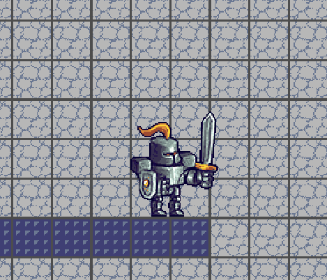

This is the source code for our amazing game, created during 4 hours of relentless and fun filled work in Hack Club Haven Manchester. The theme of this game jam is Bounce Back, so we decided to make a game filled with bouncing elements and emojis because what better way to make your day than get punched by a giant emoji fist 😁

Feel free to give the game a go!  https://circuitguy932.itch.io/emoji-kenobi

Made using the Godot Game Engine by Eduard, Noah and Kian. Courtesy of https://haven.hackclub.com/manchester!

## Gallery

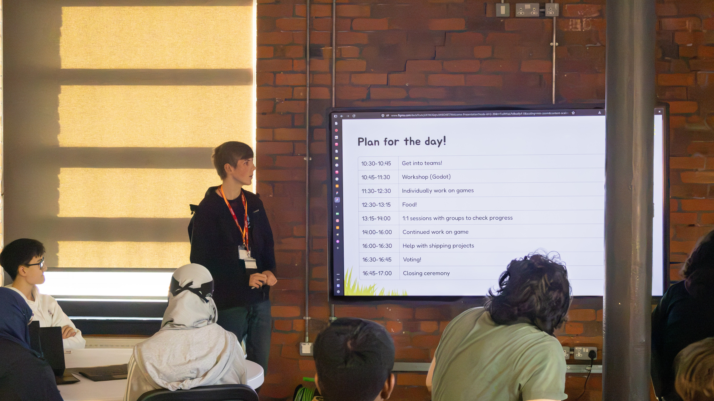
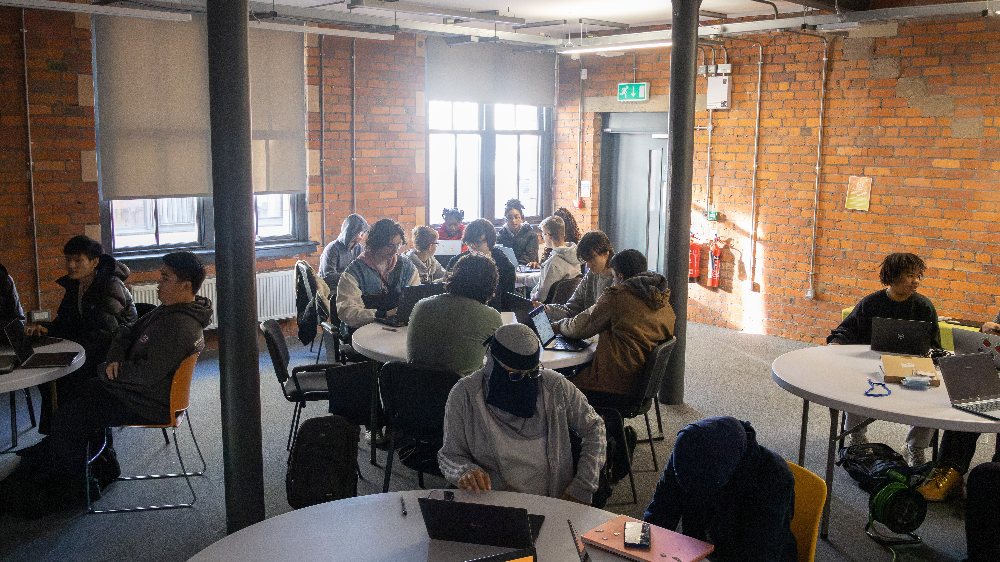
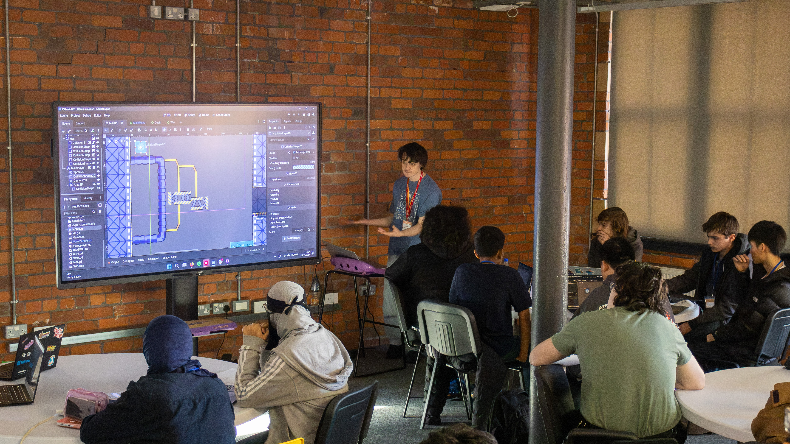
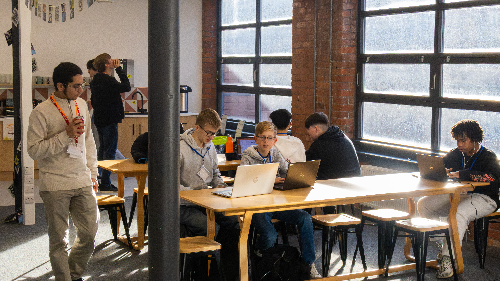
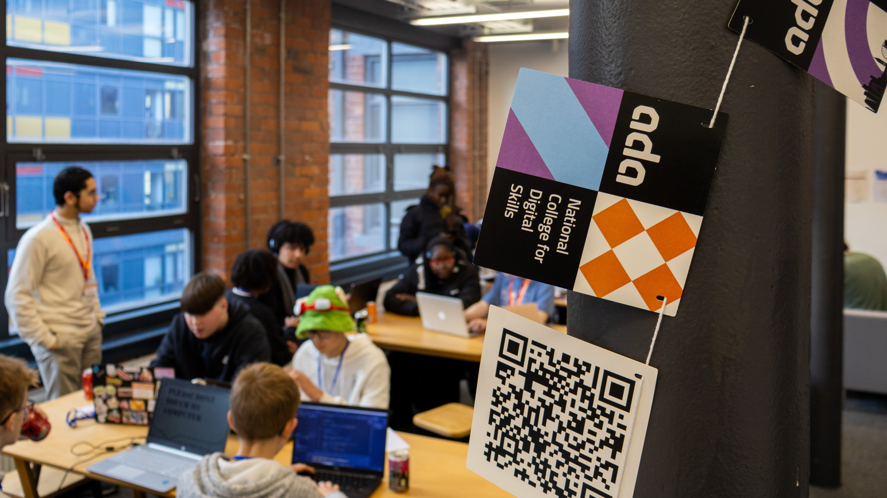
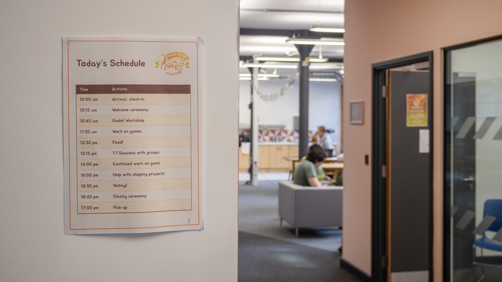
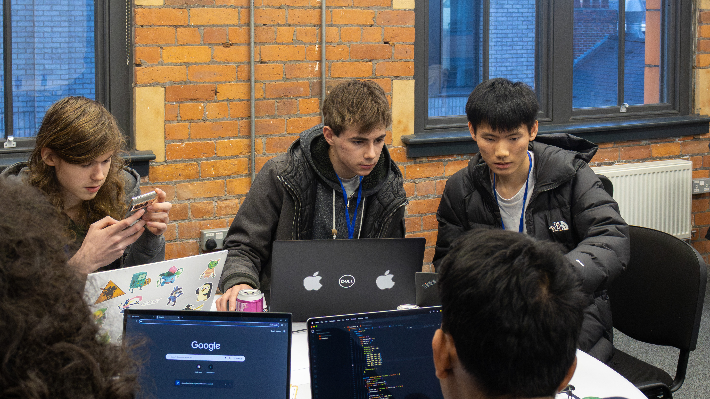
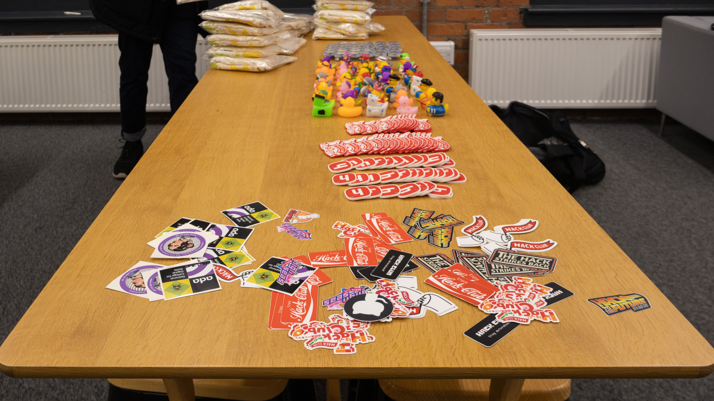
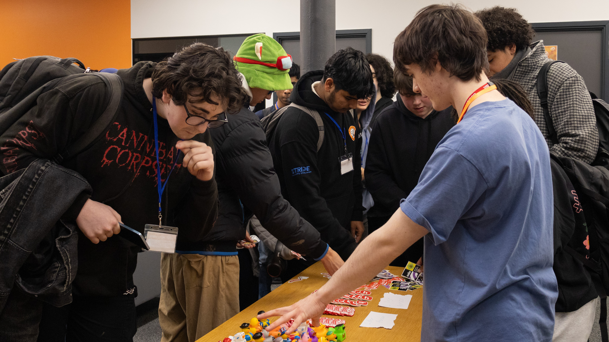
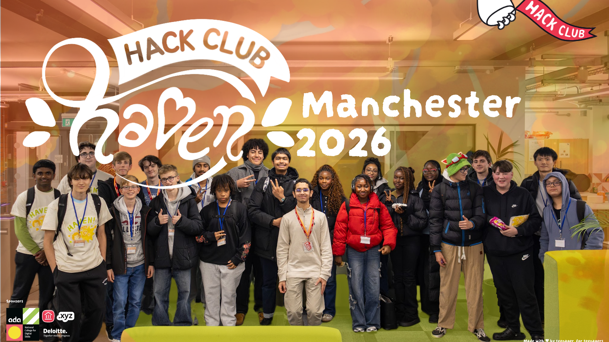
